# 🏗️ YatriKa AI — System Architecture Specification
**Production-Grade Architecture for Karnataka Travel Operating System**

---

## 1. End-to-End System Flow Diagram

```mermaid
flowchart TD
    subgraph USER_INPUT["Multimodal User Input Layer"]
        UI_VOICE["🎤 Web Speech API (kn-IN / en-IN)"]
        UI_TEXT["⌨️ Omnibar Natural Language Prompt"]
        UI_ORIGIN["📍 Gateway Selector (Bengaluru, Mysuru, Chikkamagaluru, Live GPS)"]
    end

    subgraph LINGUISTIC_ENGINE["System A: Kannada Linguistic Engine"]
        NORM["Unicode NFC Normalizer & Diacritics Cleaner"]
        GRAMMAR["Vibhakti Case Parser (-ನಿಂದ Origin, -ಗೆ Destination)"]
        DIALECT["Regional Dialect Classifier (Karavali, Malnad, UK, Mysuru)"]
        INTENT["Deterministic Intent Classifier (<50ms Execution)"]
    end

    subgraph REASONING_ENGINE["Core Travel & Corridor Intelligence"]
        CORRIDOR["Corridor Advisory Engine (Mountain passes, 18 Hairpins)"]
        ROUTING["OSRM Road Engine + Geodesic Corridor Fallback"]
        BUDGET["Itemized Budget Calculator (Backpacker, Comfort, Premium)"]
        SHAKTI["Shakti Scheme Female Zero-Fare Engine (Order TRAN 38 TEP 2023)"]
    end

    subgraph PERSISTENCE["System B: Offline Survival Layer"]
        PACK_GEN["Offline Trip Pack Compiler & CRC32 Checksum"]
        IDB["IndexedDB Repository (yatrika_offline_survival_db)"]
        EMERGENCY["Karnataka Emergency Directory (112, 108, 1077, 1926)"]
        PHRASES["In-Context Kannada Survival Cards with Web Speech TTS"]
    end

    subgraph PRESENTATION["Presentation Layer (Daylight Glassmorphism)"]
        FEED["540px Visual Itinerary Timeline (Wanderlog / Layla Style)"]
        MAP["MapLibre GL Vector Canvas (Bright / Liberty / Positron)"]
        SIMULATION["60 FPS Physics Road Vehicle Tour & Interactive HUD Scrubber"]
    end

    USER_INPUT --> LINGUISTIC_ENGINE
    LINGUISTIC_ENGINE --> REASONING_ENGINE
    REASONING_ENGINE --> PERSISTENCE
    REASONING_ENGINE --> PRESENTATION
    PERSISTENCE --> PRESENTATION
```



---

## 2. Component Interfaces & Contracts

### 2.1 Voice Agent Contract
```typescript
interface VoiceIntentResult {
  rawTranscript: string;
  normalizedText: string;
  detectedDialect: RegionalDialectZone;
  language: 'kn' | 'en' | 'mixed';
  intent: TravelIntent;
  confidence: number;
  entities: ExtractedTravelEntities;
  requiresClarification: boolean;
  suggestedAction?: 'LOAD_CIRCUIT' | 'FILTER_STOPS' | 'CHANGE_ORIGIN' | 'OPTIMIZE_ROUTE' | 'SHOW_BUDGET';
  targetCircuitId?: string;
}
```

### 2.2 Offline Pack Contract
```typescript
interface OfflineTripPack {
  id: string;
  circuitTitle: string;
  origin: { id: string; name: string; nameKannada: string; coordinates: [number, number] };
  stops: OfflineStopData[];
  totalDistanceKm: number;
  routeCoordinates: [number, number][];
  emergencyDirectory: OfflineEmergencyContact[];
  kannadaSurvivalPhrases: OfflineSurvivalPhrase[];
  shaktiGuidance: { isEligible: boolean; freeBusServices: string[]; paidExemptions: string[] };
  budgetSummary: { netTotalInr: number; lodgingInr: number; fuelInr: number; ticketsInr: number; foodInr: number };
  checksum: string;
  status: 'ready';
}
```
